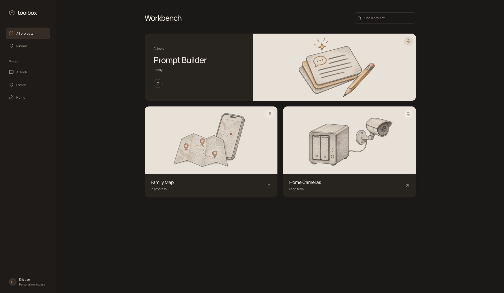
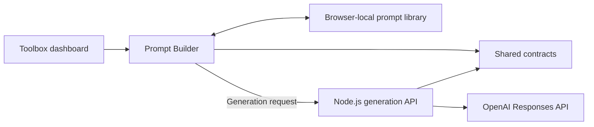

# Toolbox

A personal workbench by [Kristian Salmeron](https://github.com/kriscodes), bringing small, useful tools into one place. Its first working tool is **Prompt Builder**: a React workspace for turning an idea and saved project context into an editable prompt, then organizing that work in a local library.

**[Open Toolbox](https://toolbox.kristiansalmeron.com/)** · **[Open Prompt Builder](https://toolbox.kristiansalmeron.com/tools/prompt-builder/)** · [Architecture decisions](#architecture-and-decisions)

[](https://github.com/kriscodes/toolbox/actions/workflows/check.yml)



_Live Toolbox dashboard · November 8, 2026_

## What you can do

- Organize prompts into groups with reusable project context.
- Choose task, tone, format, and model options for a generation request.
- Edit a prompt before saving or copying it, then reopen it from the local library.
- Export and import backups without replacing existing groups and prompts.

**You can explore the editor, write prompts, and save locally without API credentials.** AI generation requires a configured API and a private Workbench access key. It is an optional, separately operated capability; the browser never receives the provider API key.

Family Map and Home Cameras are dashboard project cards. Prompt Builder is the tool implemented in this repository.

## Architecture and decisions

The dashboard and editor ship as one static browser application. A separate Node.js service handles AI generation, and a shared package defines the request contract used on both sides.



| Workspace                                                | Responsibility                                                 |
| -------------------------------------------------------- | -------------------------------------------------------------- |
| [`apps/toolbox`](apps/toolbox)                           | Vite dashboard, shared public assets, and browser entry points |
| [`tools/prompt-builder`](tools/prompt-builder)           | React editor and prompt-library behavior                       |
| [`apps/prompt-api`](apps/prompt-api)                     | Server-side AI generation gateway                              |
| [`packages/prompt-contracts`](packages/prompt-contracts) | Shared model catalog, request types, and input validation      |

Two decisions shape the first version:

1. **Keep the prompt library in the browser.** Groups, context, saved prompts, and drafts work without an account or database. Export/import provides a backup path. Data does not sync across browsers or devices. See [ADR 0002](docs/adr/0002-local-prompt-library.md).
2. **Keep generation behind a separate API.** Provider credentials stay on the server. The browser sends only the current generation input, with the current group's context when enabled. See [ADR 0003](docs/adr/0003-ai-generation-gateway.md).

[ADR 0001](docs/adr/0001-monorepo-tool-boundaries.md) covers the npm workspace boundaries and shared static deployment.

## Run locally

Use Node **22.23.4**, matching [`.node-version`](.node-version), and npm. From a local checkout:

```sh
npm ci
npm run dev
```

Open the URL printed by Vite. The dashboard is at `/`; Prompt Builder is at `/tools/prompt-builder/`. Editing and local saving work without the generation service.

To enable AI generation locally, follow [API setup](docs/operations.md#local-ai-generation-setup). Run `npm run dev:api` in a second terminal after configuring its environment. Vite forwards `/api` to port `3001`.

## Quality checks

```sh
npm run verify
```

This command runs ESLint, workspace tests, TypeScript checks, and the production browser build. Individual commands are `npm run lint`, `npm test`, `npm run check`, and `npm run build`.

The tests cover request validation, API authorization and failure behavior, prompt-library integrity, and dashboard behavior. Provider calls are injected in tests, so the suite does not require an API key or incur generation charges. A live generation check is a separate deployment step. The [Check workflow](.github/workflows/check.yml) defines CI for pull requests and changes to `main`; its latest results are available in [Actions](https://github.com/kriscodes/toolbox/actions).

## Scope and limitations

- The local library belongs to the current browser profile and origin. Export a backup before clearing site data or changing browsers.
- Imports add copies. Invalid saved data is retained for recovery, and storage failures are reported in the interface.
- The generation access key is a single-owner gate, not a multi-user account system. It stays in memory for the current visit.
- Rate limits are local to one API process and reset on restart. They are not a monthly spending cap.
- Mocked provider tests check application behavior; they cannot establish the quality or scope preservation of real model output. See the [generation evaluation cases](docs/prompt-generation-evaluation.md).

## Operations and maintenance

[Operations guide](docs/operations.md) covers environment variables, Render deployment, model settings, generation limits, coding conventions, and artwork regeneration. The dashboard uses warm charcoal, pencil illustrations, and self-hosted Manrope; source artwork and font licensing remain in the repository.
