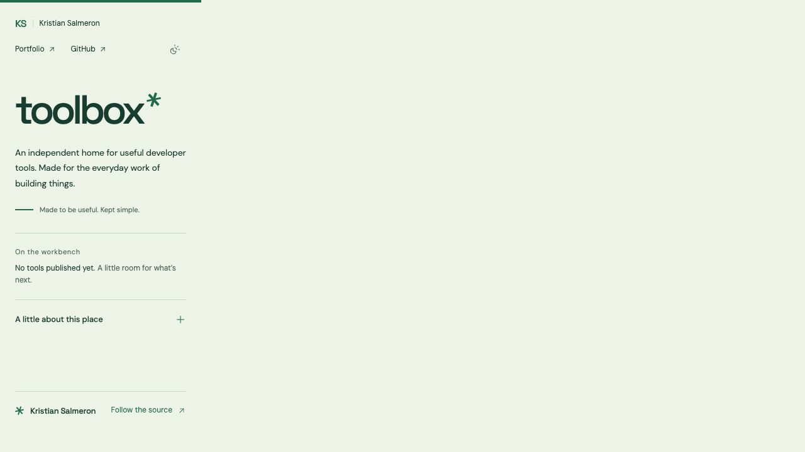
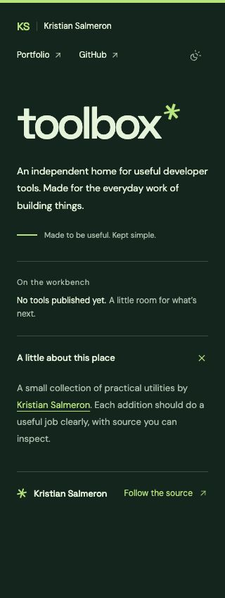

# Toolbox redesign validation

Review date: November 8, 2026. Archive base: `c13d02dda8d596b0e4616f3bbc4eaa7ff44e591c`. Upstream documentation reconciled through `adbc128`.

## Resulting behavior

The public homepage implements the reviewed open composition with the working Pine & mint palette: Space Grotesk wordmark, geometric stamp, horizontal navigation, flat publication status, native About expansion, and an author/source footer. There is no sidebar, central collection pane, placeholder utility, palette picker, or preview-only design control.

Prompt Builder, Family Map, and Home Cameras remain absent from public listings, pages, artwork, and application bundles. The original workbench remains preserved in `archive/2026-11-toolbox/`. The retained editor, generation API, contracts, original storage semantics, and npm lockfile are unchanged.

Both typefaces are served locally with their licenses. The favicon and sharing image match the new stamp and colors. The sharing image remains reproducible from its vector source using the committed fonts and an ignored local font cache.

## Automated checks

Checked using Node 22.23.4:

- ESLint: passed with no warnings.
- All 55 tests: passed (17 API/generator, 9 web/archive/appearance, 21 editor/client/library, 3 contracts, 5 public-output audit regressions).
- TypeScript checks for all workspaces: passed.
- Public Vite production build: passed.
- Public build audit: passed; 11 files and 6 referenced resources. Checks cover metadata, static readable content, crawler files, missing resources, retired routes/artwork/API code, and storage clearing.
- Existing appearance tests were updated only for the new light/dark browser-chrome colors. They execute the actual delivered head bootstrap and theme controller, checking persistence, cross-tab behavior, unavailable storage, and exact preservation of valid and malformed archived data.
- No new tests mirror the static layout. Native About behavior and responsive composition are covered by browser review.

The API suite needs permission to bind temporary local loopback ports. An initial restricted run failed with `listen EPERM`; the complete required verification passed when run with local-listener access. Provider calls remain mocked, with no paid requests or production API changes.

## Upstream reconciliation

The base branch advanced with documentation-only commits while the design was being reviewed. The local branch merges those commits, preserving their operations guide and dashboard image. Its README conflict is resolved around the current archived/public split, with the CI badge and operational links retained. An exact copy of the upstream overview is retained in `archive/2026-11-toolbox/UPSTREAM-OVERVIEW.md`; the operations guide is explicitly labeled as historical for the archived application.

## Browser review

The production build was reviewed at desktop and 320px mobile widths. The composition matches the approved direction, no horizontal overflow was observed, native About expansion works, and dark appearance persists after reload. The screenshots below record the current implementation; earlier preview images are superseded.

A browser review is not a complete WCAG audit or cross-browser certification. Production deployment remains a separate owner-approved action.

## Release boundary

This change prepares the existing feature branch and pull request. It does not deploy Toolbox, merge it to main, change DNS, stop an API service, or change credentials. Existing browser data stays on its original origin; the archive guide explains recovery constraints.
