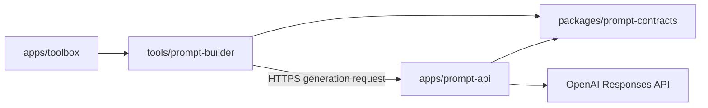

# ADR 0001: npm workspaces and tool boundaries

- Date: 2026-11-02
- Status: Accepted

## Context

Toolbox began as a single Vite dashboard. The owner now wants a monorepo containing Toolbox and the tools it launches, starting with Prompt Builder. The live dashboard, artwork, domain, and Render publish directory should survive this change.

## Decision

Use npm workspaces with one lockfile:

- `apps/toolbox` owns the existing dashboard, public assets, and browser entry points.
- `tools/prompt-builder` owns the Workbench UI and prompt-library behavior.
- `apps/prompt-api` owns server-side prompt generation.
- `packages/prompt-contracts` owns the model catalog and validated request contract used by the browser and API.

Keep the dashboard's existing TypeScript implementation. Use React for the stateful prompt editor, mounted through its own exported entry point. Vite builds separate HTML entry points for `/` and `/tools/prompt-builder/`, both into root `dist/`. The tool is a source workspace bundled by the shell, not an independently deployed website.

## Consequences

Future tools can be developed in separate workspaces while sharing navigation and deployment. No monorepo orchestration service is needed at this size. The existing static site's build and publish paths remain valid, and nested refreshes resolve to a real HTML file.

The shell and tool ship together; a tool change rebuilds the browser application. The API is a separate service because it holds secrets and receives requests. Introducing a shared component library, additional backend services, or independent tool deployments should follow an actual reuse or operational need.

## Alternatives

Separate Git repositories would make shared changes and local development harder. Putting every tool directly into the dashboard's source directory would remove useful ownership boundaries. Migrating the entire dashboard to React would add work without improving this first tool.
